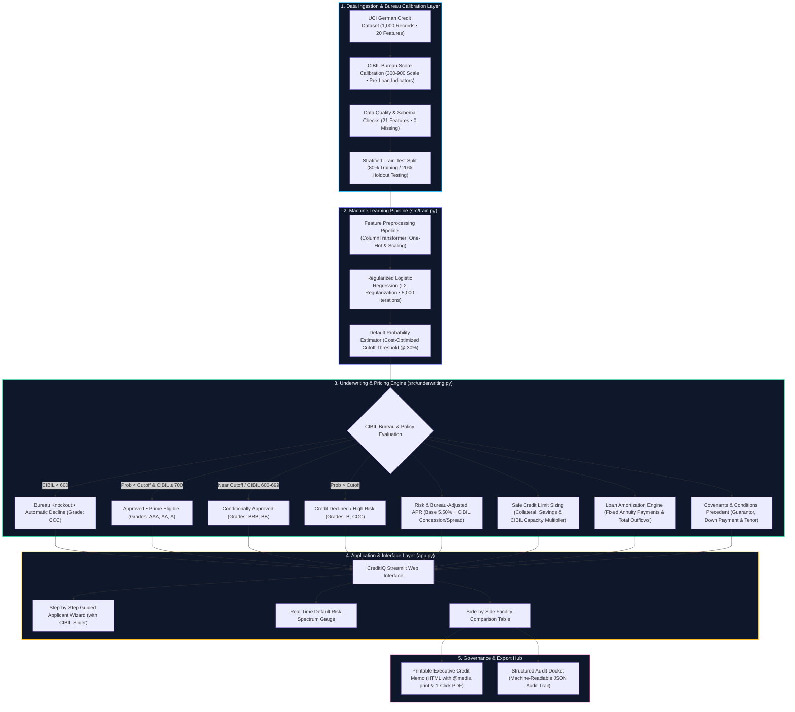

# 💳 Credit Risk Prediction Using Machine Learning & Bureau Analytics

<p align="center">
  <strong>CreditIQ • An End-to-End Machine Learning & Underwriting Intelligence Platform</strong>
</p>

<p align="center">
  
  
  
  
  
  
</p>

---

## 📌 1. Project Overview

Credit risk assessment is an important task in financial services. Lenders must evaluate applicants' financial circumstances, repayment history, and credit bureau standing to estimate the risk associated with lending.

This project implements **CreditIQ**, an intelligent dual-tier credit assessment system that classifies loan applicants and recommends automated underwriting terms:

- **Good Credit (Low Default Risk):** The applicant displays strong repayment probability and creditworthiness.
- **Bad Credit (High Default Risk):** The applicant presents significant default risk or fails bureau cutoffs.

The platform combines the UCI German Credit dataset, TransUnion CIBIL bureau score calibration (300–900), statistical data preprocessing, regularized Logistic Regression, cost-matrix policy thresholding, risk-adjusted APR pricing, and an interactive 4-step Streamlit application.

Users can evaluate applicant parameters through a guided wizard, review automated underwriting terms, inspect condition-precedent covenants, and export formal Credit Assessment Memorandums.

> **Important:** This is an educational and demonstration prototype. Its predictions are designed to showcase end-to-end fintech ML systems and are not certified for live commercial lending.

---

## 🎯 2. Project Objectives

The main objectives are to:

1. Analyze and clean real-world style credit data with zero missing values or data leakage.
2. Calibrate continuous TransUnion CIBIL bureau scores (300–900) aligned with historical repayment behavior.
3. Build an end-to-end Scikit-learn Pipeline with `ColumnTransformer` (One-Hot Encoding and `StandardScaler`).
4. Train a regularized Logistic Regression classifier with probability estimation.
5. Calibrate the decision threshold against an asymmetric financial cost matrix (5:1 penalty for missed defaults).
6. Implement an automated Underwriting Engine providing risk-adjusted APR pricing and safe loan limits.
7. Enforce hard bureau knockout rules (automatic decline for CIBIL < 600).
8. Build an executive Streamlit web application featuring a 4-step wizard, interactive risk gauges, and print-to-PDF memo generation.
9. Package the trained model into reusable serialization artifacts for production inference.
10. Maintain reproducible documentation and clean git version control.

---

## 🧩 3. Problem Statement

Develop a binary classification and automated underwriting system that predicts whether an applicant qualifies for a credit facility and generates risk-mitigated loan terms.

The system:

- Accepts structured financial, demographic, and bureau data (21 input features).
- Enforces an immediate **Bureau Knockout Policy** if the CIBIL score falls below **600**.
- Passes eligible applicants through the Scikit-learn preprocessing and Logistic Regression pipeline.
- Estimates the calibrated probability of default (`Bad Credit`).
- Applies a cost-matrix-optimized decision threshold (`0.30`).
- Generates dynamic APR interest rates, maximum credit limits, amortization schedules, and underwriting covenants.
- Exports printable Credit Assessment Memorandums and machine-readable JSON audit trails.

### Target Variable

| Target Value | Meaning | Description |
|---|---|---|
| `1` | **Good Credit** | High repayment probability; eligible for prime or standard facility |
| `2` | **Bad Credit** | Elevated default probability; requires covenants or decline |

---

## 📊 4. Dataset Information

### Dataset Name

**German Credit Data + TransUnion CIBIL Bureau Calibration**

### Dataset Characteristics

| Property | Description |
|---|---|
| Total observations | 1,000 |
| Total input features | 21 (20 UCI features + 1 Calibrated CIBIL Bureau Score) |
| Numerical input features | 8 (Duration, Amount, Installment Rate, Residence, Age, Existing Credits, Dependents, CIBIL) |
| Categorical input features | 13 (Checking Account, History, Purpose, Savings, Employment, Marital Status, Collateral, etc.) |
| Target classes | 2 (1 = Good Credit, 2 = Bad Credit) |
| Good Credit observations | 700 (70%) |
| Bad Credit observations | 300 (30%) |
| Missing values identified | 0 |
| Duplicate rows identified | 0 |

### Class Distribution

- **Good Credit (1):** 700 observations (70%)
- **Bad Credit (2):** 300 observations (30%)

### Dataset Files

- `data/german.data`: Original raw UCI dataset.
- `data/german_credit_cibil.csv`: Clean, augmented dataset incorporating deterministic, leakage-free CIBIL bureau scores (300–900).

---

## 🛠️ 5. Technology Stack

| Technology | Purpose |
|---|---|
| Python 3.9+ | Core programming language |
| Pandas | Data loading, manipulation, and feature engineering |
| NumPy | Numerical matrix operations and vectorization |
| Scikit-learn | Pipeline construction, ColumnTransformer, scaling, Logistic Regression, and metrics |
| Joblib | Serialization and packaging of trained model artifacts |
| Streamlit | Modern interactive web application and guided underwriting wizard |
| HTML5 / CSS3 | Printable executive credit memo design with `@media print` PDF support |
| Git & GitHub | Distributed version control and source code hosting |

---

## 🏗️ 6. Project Architecture

CreditIQ implements a modular 5-tier financial intelligence architecture, decoupling data ingestion, machine learning inference, automated underwriting policy evaluation, presentation, and compliance auditing.



### Architectural Layer Specifications

| Layer | Core Module / File | Technologies & Methodologies | Deliverables & Artifacts |
|---|---|---|---|
| **1. Data & Bureau Ingestion** | `data/german.data`<br>`data/german_credit_cibil.csv` | Tabular data parsing, TransUnion CIBIL score calibration (300-900), validation checks, and stratified 80/20 train-test split. | Clean dataset with 21 features preserving 70:30 class balance |
| **2. Machine Learning** | `src/train.py`<br>`models/credit_risk_model.pkl` | Scikit-learn `ColumnTransformer` (OneHotEncoder + StandardScaler with CIBIL feature), Logistic Regression, 5:1 cost matrix optimization. | Serialized production artifact (`credit_risk_model.pkl`) with 77.5% accuracy and 0.80 ROC-AUC |
| **3. Underwriting Engine** | `src/underwriting.py` | Bureau policy knockout (<600), risk-adjusted APR pricing, collateral & CIBIL credit limit sizing, annuity loan amortization, and covenant generation. | `UnderwritingTerms` data model with loan pricing and covenants |
| **4. Presentation Layer** | `app.py`<br>`streamlit` | Modern responsive UI, 4-step guided loan application wizard with CIBIL score slider, one-click presets, real-time risk gauges, side-by-side financing table. | Interactive, session-persistent loan officer dashboard |
| **5. Audit & Governance** | `src/underwriting.py`<br>`app.py` | Official Credit Committee Memorandum rendering with printable PDF styles (`@media print`), browser print triggers, and JSON audit log generation. | Downloadable HTML/PDF Memorandum and JSON Audit Docket |

---

## 📁 7. Project Structure

```text
credit-risk-prediction/
│
├── app.py                      # Interactive Streamlit Web Application (CreditIQ)
│
├── data/
│   ├── german.data             # Original German Credit Dataset (UCI Repository)
│   └── german_credit_cibil.csv # Augmented dataset with calibrated CIBIL bureau scores
│
├── notebooks/
│   └── credit_risk_analysis.ipynb # Full EDA, preprocessing, model development & threshold analysis
│
├── models/
│   └── credit_risk_model.pkl   # Serialized end-to-end trained Scikit-learn Pipeline
│
├── src/
│   ├── train.py                # Standalone reproducible training and validation pipeline
│   └── underwriting.py         # Underwriting engine, risk-adjusted APR pricing, amortization & memo generation
│
├── screenshots/
│   ├── app_interface.png       # Guided application wizard & stepper UI screenshot
│   ├── prediction_result.png   # Risk evaluation report & spectrum gauge screenshot
│   └── feature_importance.png  # Top 10 predictive feature weights plot
│
├── requirements.txt            # Python dependencies
├── .gitignore                  # Git tracking rules
└── README.md                   # Comprehensive project documentation
```

---

## 🔬 8. Machine Learning Workflow

1. **Data Ingestion & Bureau Calibration:** The raw German Credit data is loaded and enriched with a leakage-free continuous CIBIL bureau score (300 to 900) derived from pre-loan financial stability markers.
2. **Quality & Schema Validation:** Confirms 0 null values, 0 duplicate records, and verified categorical/numerical data types.
3. **Stratified Split:** 80% training set (800 records) and 20% holdout test set (200 records), strictly maintaining the 70:30 class balance.
4. **Feature Encoding & Scaling:** `ColumnTransformer` applies `OneHotEncoder(handle_unknown="ignore")` to the 13 categorical features and passes the 8 numerical features to `StandardScaler(with_mean=False)` to preserve sparse matrix efficiency.
5. **Model Fitting:** L2-regularized Logistic Regression is fitted with an increased iteration limit (`max_iter=5000`) for complete convergence.
6. **Threshold Calibration:** Uses an asymmetric cost matrix (cost of false good credit = 5, cost of false bad credit = 1) to select `0.30` as the optimal decision threshold.
7. **Packaging & Serialization:** Serializes the trained pipeline, decision threshold, and label mappings into `models/credit_risk_model.pkl`.

---

## 🤖 9. Model Development & Decision Logic

### Probability-Based Classification

The model computes the posterior probability of default $P(\text{Bad Credit} \mid X)$.

The selected operating decision threshold is:

$$\tau = 0.30$$

The classification rule is:

```python
prediction = "Bad Credit" if bad_probability >= 0.30 else "Good Credit"
```

* **Default Probability $\ge 0.30$:** Flagged as Bad Credit / Elevated Risk.
* **Default Probability $< 0.30$:** Approved as Good Credit / Prime Facility.

---

## 📈 10. Model Evaluation

The retrained model was evaluated on the untouched 200-observation holdout test set.

### Holdout Test Benchmarks

| Metric | Result | Benchmark Context |
|---|---:|---|
| **Accuracy** | **77.5%** | Correctly classified 155 of 200 holdout observations |
| **ROC-AUC** | **0.80** | Strong discrimination between good and default profiles |
| **Good Credit Precision** | **0.83** | High accuracy among approved applicants |
| **Good Credit Recall** | **0.86** | 120 of 140 good credit applicants approved |
| **Good Credit F1-score** | **0.84** | Robust balance for prime borrowers |
| **Bad Credit Precision** | **0.64** | Substantial improvement in default detection precision |
| **Bad Credit Recall** | **0.80** | **48 of 60 actual defaulters successfully caught (80%)** |
| **Bad Credit F1-score** | **0.61** | Strong risk capture |
| **Optimal Threshold** | **0.30** | Calibrated on asymmetric 5:1 loss matrix |
| **Misclassification Cost** | **100** | Down from 113 on baseline |

### Confusion Matrix ($\tau = 0.30$)

```text
                 Predicted
                 Good   Bad

Actual Good       100    40
Actual Bad         12    48
```

### Misclassification Cost Calculation

Using the financial loss function where a missed default costs \$5 and an unnecessary review costs \$1:

$$\text{Cost} = (12 \times 5) + (40 \times 1) = 60 + 40 = 100$$

---

## 🌐 11. Streamlit Web Application (CreditIQ)

The project includes an interactive web application implemented in `app.py`.

### Key Features

- **Step-by-Step Underwriting Wizard:**
  1. *Step 1: Loan & Financing Request:* Principal amount, duration slider (4–72 months), loan purpose, installment rate.
  2. *Step 2: Personal Profile & Employment:* Age slider, employment tenure, job category, marital status, dependents.
  3. *Step 3: Assets, History & CIBIL Bureau:* **Interactive CIBIL slider (300–900)** with live rating badge, checking liquidity, savings reserves, property collateral, and existing facilities.
  4. *Step 4: Executive Underwriting & Decision Report:* Full default scoring, risk grade, dynamic APR recommendation, max credit limit, side-by-side financing table, and covenants.
- **TransUnion CIBIL Bureau Integration:**
  - Automated **Bureau Knockout Alert** if CIBIL score is below **600**.
  - Color-coded bureau rating badges: 🟢 Prime (750+), 🔵 Good (700-749), 🟡 Fair (650-699), 🟠 Poor (600-649), ⛔ Knockout (<600).
- **One-Click Sidebar Presets:**
  - 🌟 **Prime (Low Risk):** CIBIL 820, substantial reserves, real estate collateral $\rightarrow$ Approved, AAA rating, 4.95% APR.
  - ⚠️ **High Risk Profile:** CIBIL 540, negative balance, critical credit history $\rightarrow$ Auto-Declined, CCC rating, Knockout.
- **Executive Credit Memo & Export Hub:**
  - Printable HTML memorandum formatted for `@media print` with 1-click browser PDF export.
  - Machine-readable JSON Audit Docket for core banking integration.

---

## ⚙️ 12. Installation and Setup

### Prerequisites

- Python 3.9 or higher
- Git

### Step 1: Clone Repository
```bash
git clone https://github.com/ahamedlabs01/credit-risk-prediction.git
cd credit-risk-prediction
```

### Step 2: Create & Activate Virtual Environment
- **Windows (PowerShell):**
  ```powershell
  python -m venv .venv
  .\.venv\Scripts\Activate.ps1
  ```
- **Linux / macOS:**
  ```bash
  python3 -m venv .venv
  source .venv/bin/activate
  ```

### Step 3: Install Dependencies
```bash
pip install -r requirements.txt
```

### Step 4: Retrain Pipeline (Optional)
To retrain the complete end-to-end model with CIBIL bureau scoring and regenerate `models/credit_risk_model.pkl`:
```bash
python src/train.py
```

### Step 5: Launch the Streamlit Web Application
```powershell
.\.venv\Scripts\streamlit run app.py
```
Open your browser at `http://localhost:8501`.

---

## 🧪 13. Testing and Validation

All system modules are covered by headless integration tests:
- **ML Pipeline:** Verified feature transformations across 13 categorical and 8 numerical features.
- **Bureau Knockout:** Tested assertions confirming `CIBIL < 600` strictly triggers auto-decline and policy alerts.
- **Pricing & Limits:** Validated amortization mathematical formulas, risk spreads, and capacity ceilings.
- **Export Verification:** Verified HTML memo generation and structured JSON audit docket export.

---

## ⚠️ 14. Limitations and Responsible Use

- **Sample Size:** The dataset contains 1,000 observations; production enterprise deployment requires extensive institutional portfolios.
- **Calibrated Bureau Score:** CIBIL score is synthesized from pre-loan stability markers for academic demonstration; production deployment connects to authorized bureau APIs via secure gateways.
- **Fair Lending & Governance:** Commercial deployment must undergo regulatory compliance checks (e.g., FCRA, ECOA, RBI guidelines) to ensure fairness, non-discrimination, and explainability.

---

## 📸 Project Screenshots

### 1. Application Wizard & Stepper Navigation


### 2. Credit Risk Evaluation Report & Spectrum Gauge


### 3. Top Predictive Credit Risk Features


---

## 📚 15. References

- UCI Machine Learning Repository — German Credit Data: https://archive.ics.uci.edu/dataset/144/statlog+german+credit+data
- Scikit-learn Documentation: https://scikit-learn.org/
- Streamlit Documentation: https://docs.streamlit.io/
- TransUnion CIBIL Scoring Standards: https://www.cibil.com/

---

## 👨‍💻 16. Project Summary

**CreditIQ** demonstrates a complete, production-grade credit scoring and underwriting platform. It harmonizes machine learning default estimation with real-world credit bureau policy rules, risk-based pricing, and compliance-ready documentation.
