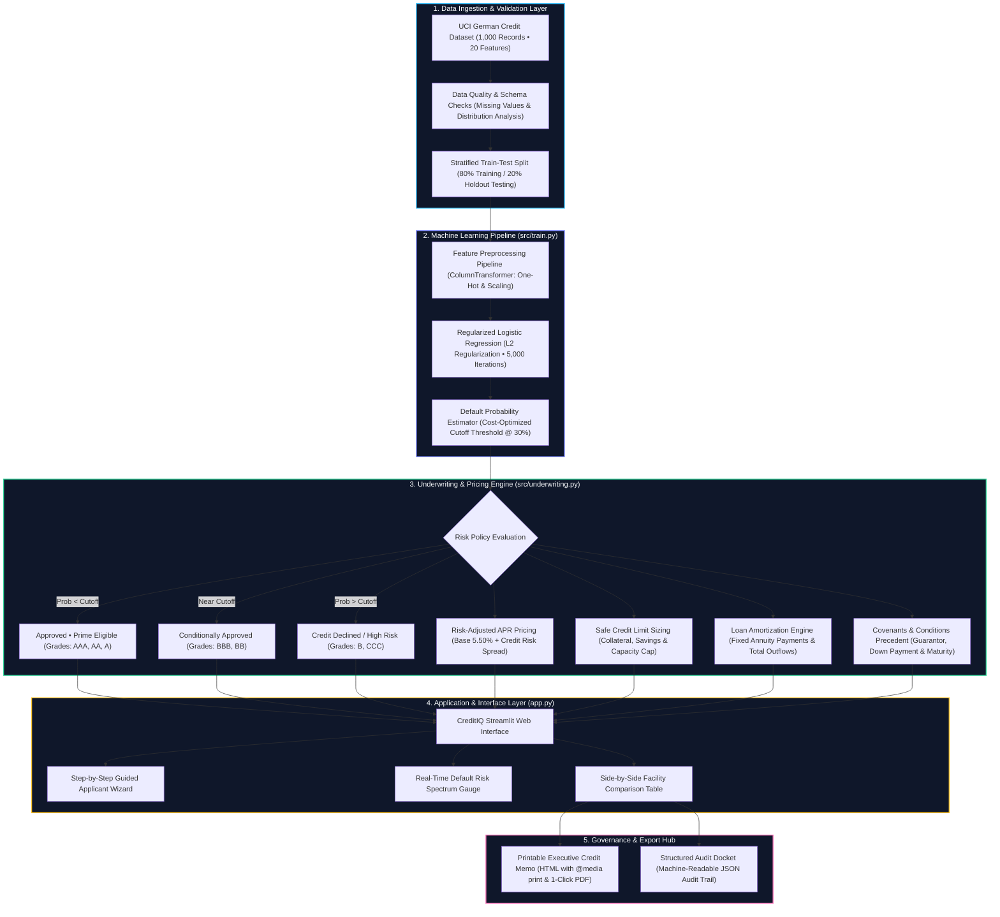
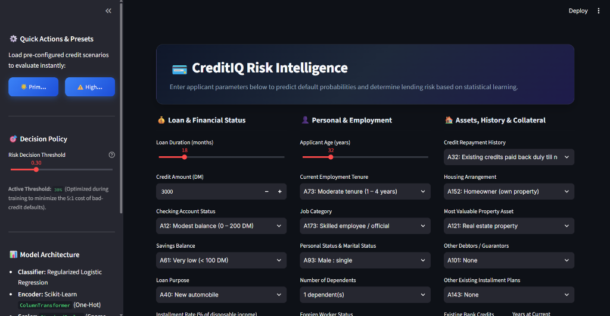
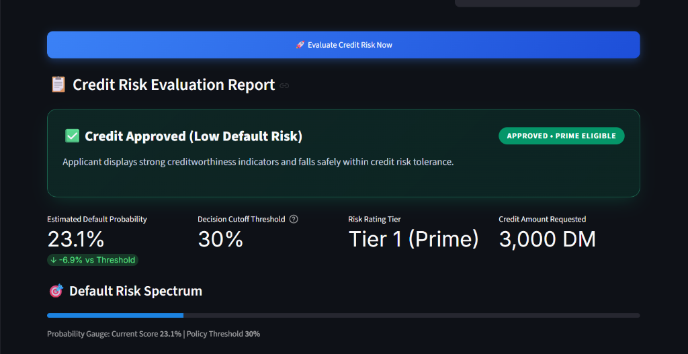
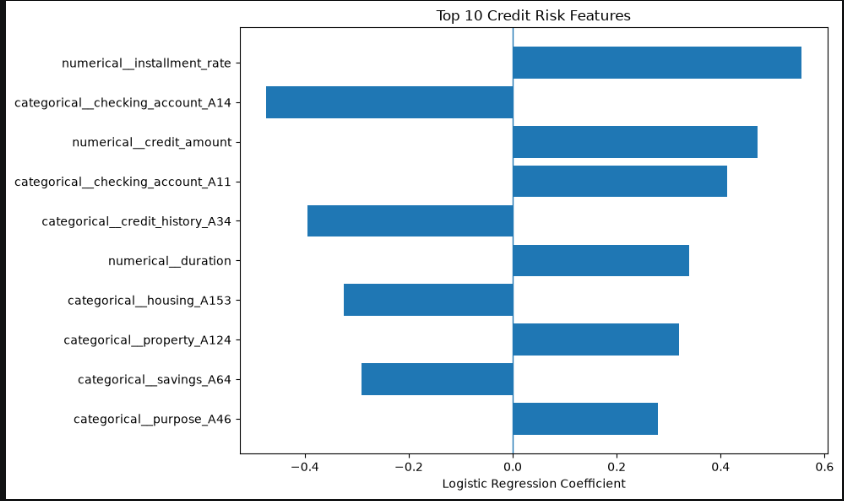

# 💳 Credit Risk Prediction Using Machine Learning

<p align="center">
  <strong>An End-to-End Machine Learning Project for Credit Risk Classification</strong>
</p>

<p align="center">
  
  
  
  
  
</p>

---

## 📌 1. Project Overview

Credit risk assessment is an important task in financial services. Lenders must evaluate applicants' financial circumstances and credit history to estimate the risk associated with lending.

This project develops a machine learning system that classifies applicants into two categories:

- **Good Credit:** The applicant belongs to the dataset's good-credit class.
- **Bad Credit:** The applicant belongs to the dataset's bad-credit class.

The project uses the German Credit dataset, data preprocessing, exploratory data analysis (EDA), Logistic Regression, model evaluation, and a Streamlit web application.

Users can enter applicant information through a web interface and receive a predicted credit category and an estimated probability of belonging to the Bad Credit class.

> **Important:** This is an educational prototype. Its predictions are not validated for real-world lending decisions.

---

## 🎯 2. Project Objectives

The main objectives are to:

1. Understand and analyze a real-world-style credit classification dataset.
2. Clean and prepare data for machine learning.
3. Explore relationships between applicant characteristics and credit classification.
4. Encode categorical features for model training.
5. Train a Logistic Regression classifier.
6. Evaluate performance using appropriate classification metrics.
7. Investigate the cost of different classification errors.
8. Select a probability threshold using validation data.
9. Analyze model coefficients to understand influential features.
10. Build an interactive prediction application using Streamlit.
11. Package the trained model for reuse.
12. Document the complete machine learning workflow for reproducibility.

---

## 🧩 3. Problem Statement

Develop a binary classification model that predicts whether a credit applicant belongs to the Good Credit or Bad Credit class based on the applicant's financial and personal information.

The system should:

- Accept structured applicant data.
- Apply the same preprocessing used during training.
- Estimate the probability of Bad Credit.
- Apply a selected classification threshold.
- Display the predicted category through a web interface.

### Target Variable

The dataset uses the following target encoding:

| Target Value | Meaning |
|---|---|
| `1` | Good Credit |
| `2` | Bad Credit |

These labels represent the dataset's classification categories. They should not be interpreted as guaranteed future repayment outcomes.

---

## 📊 4. Dataset Information

### Dataset Name

**German Credit Data**

### Dataset Characteristics

| Property | Description |
|---|---|
| Total observations | 1,000 |
| Original input features | 20 |
| Numerical input features | 7 |
| Categorical input features | 13 |
| Target classes | 2 |
| Good Credit observations | 700 |
| Bad Credit observations | 300 |
| Missing values identified | 0 |
| Duplicate rows identified | 0 |

The dataset contains applicant information such as credit history, account status, credit amount, employment, savings, age, housing, and other financial characteristics.

### Class Distribution

The target distribution is:

- Good Credit: 700 observations (70%)
- Bad Credit: 300 observations (30%)

This imbalance is relevant when interpreting accuracy and class-specific performance metrics.

### Dataset Source

The project uses the German Credit dataset distributed by the UCI Machine Learning Repository.

Dataset information:
https://archive.ics.uci.edu/dataset/144/statlog+german+credit+data

### Dataset Limitations

- The dataset contains only 1,000 observations.
- Its class distribution is imbalanced.
- It may not represent current lending populations.
- Its category codes require careful interpretation.
- Model performance on this dataset does not establish performance on other populations.

---

## 🛠️ 5. Technology Stack

| Technology | Purpose |
|---|---|
| Python | Core programming language |
| Pandas | Data loading and manipulation |
| NumPy | Numerical operations |
| Matplotlib | Data visualization |
| Seaborn | Exploratory data visualization |
| Scikit-learn | Preprocessing, model training, and evaluation |
| Logistic Regression | Classification algorithm |
| Jupyter Notebook | Interactive experimentation |
| Joblib | Model serialization |
| Streamlit | Interactive web application |
| Git | Version control |
| GitHub | Source code hosting |

---

## 🏗️ 6. Project Architecture

CreditIQ implements a modular 5-tier financial intelligence architecture, decoupling data ingestion, machine learning inference, automated underwriting policy evaluation, presentation, and compliance auditing.



### Architectural Layer Specifications

| Layer | Core Module / File | Technologies & Methodologies | Deliverables & Artifacts |
|---|---|---|---|
| **1. Data Ingestion** | `data/german.data`<br>`notebooks/credit_risk_analysis.ipynb` | Tabular data parsing, validation checks, EDA distributions, and stratified 80/20 train-test split. | Clean training and test sets preserving 70:30 class balance |
| **2. Machine Learning** | `src/train.py`<br>`models/credit_risk_model.pkl` | Scikit-learn `ColumnTransformer` (OneHotEncoder + StandardScaler), Logistic Regression, 5:1 cost matrix optimization. | Serialized production artifact (`credit_risk_model.pkl`) with calibrated 30% decision cutoff |
| **3. Underwriting Engine** | `src/underwriting.py` | Risk-adjusted APR pricing, collateral-based credit limit sizing, annuity loan amortization, and profile-tailored condition-precedent generation. | `UnderwritingTerms` data model with loan pricing and covenants |
| **4. Presentation Layer** | `app.py`<br>`streamlit` | Modern responsive UI, 4-step guided loan application wizard, one-click preset profiles (Prime vs High Risk), real-time risk gauges, side-by-side financing table. | Interactive, session-persistent loan officer dashboard |
| **5. Audit & Governance** | `src/underwriting.py`<br>`app.py` | Official Credit Committee Memorandum rendering with printable PDF styles (`@media print`), browser print triggers, and JSON audit log generation. | Downloadable HTML/PDF Memorandum and JSON Audit Docket |

---

## 📁 7. Project Structure

```text
credit-risk-prediction/
│
├── app.py                      # Interactive Streamlit Web Application (CreditIQ)
│
├── data/
│   └── german.data             # German Credit Dataset (UCI Machine Learning Repository)
│
├── notebooks/
│   └── credit_risk_analysis.ipynb # Full EDA, preprocessing, model development & threshold analysis
│
├── models/
│   └── credit_risk_model.pkl   # Serialized end-to-end trained Scikit-learn Pipeline
│
├── src/
│   ├── train.py                # Standalone reproducible training and validation pipeline
│   └── underwriting.py         # Underwriting engine, risk-adjusted APR pricing, amortization & memo generation
│
├── screenshots/
│   ├── app_interface.png       # Guided application wizard & stepper UI screenshot
│   ├── prediction_result.png   # Risk evaluation report & spectrum gauge screenshot
│   └── feature_importance.png  # Top 10 predictive feature weights plot
│
├── requirements.txt            # Python dependencies
├── .gitignore                  # Git tracking rules
└── README.md                   # Comprehensive project documentation
```

### Directory Description

| File or Directory | Purpose |
|---|---|
| `app.py` | Modern Streamlit web application (CreditIQ) featuring a 4-step loan application wizard, underwriting engine, and memo export hub |
| `src/underwriting.py` | Underwriting & pricing engine: risk-adjusted APR spreads, max safe credit limits, amortization schedules, covenants, and HTML/JSON memo generators |
| `src/train.py` | Standalone reproducible training, metric evaluation, cost-matrix optimization, and pipeline packaging |
| `data/` | Dataset directory containing the raw `german.data` file |
| `notebooks/` | Jupyter Notebook containing data exploration, visualization, feature engineering, and model training |
| `models/` | Serialized trained Scikit-learn Pipeline (`credit_risk_model.pkl`) containing preprocessing, scaling, and classification |
| `screenshots/` | Interface and evaluation result screenshots embedded in documentation |
| `requirements.txt` | Complete list of pinned dependencies for easy replication |
| `README.md` | Comprehensive project documentation and guides |

---

## 🔬 8. Machine Learning Workflow

### Phase 1: Data Loading

The dataset is loaded into a Pandas DataFrame with descriptive column names.

The dataset contains 20 input features and one target column.

### Phase 2: Data Quality Checks

The following checks were performed:

- Dataset dimensions
- Column names and data types
- Missing values
- Duplicate rows
- Target class distribution

The initial analysis found no missing values or duplicate rows.

### Phase 3: Exploratory Data Analysis

Exploratory analysis was performed to understand the dataset.

The analysis included:

- Target class distribution
- Credit duration distribution
- Credit amount distribution
- Boxplots for numerical features
- Examination of numerical and categorical variables

EDA helps identify patterns and potential data issues before model training.

### Phase 4: Train-Test Separation

The original dataset was divided into training and test data.

The initial split contained:

| Dataset | Observations |
|---|---:|
| Training | 800 |
| Test | 200 |

Stratification was used to preserve the target class proportions.

### Phase 5: Data Preprocessing

Categorical variables were converted into numerical representations using One-Hot Encoding.

The encoder used:

`OneHotEncoder(handle_unknown="ignore")`

This approach allows the preprocessing pipeline to handle previously unseen categories without failing.

Numerical features were passed through the categorical preprocessing stage unchanged.

### Phase 6: Feature Scaling

`StandardScaler(with_mean=False)` was used before Logistic Regression.

This scaling configuration is compatible with sparse matrices produced by One-Hot Encoding.

### Phase 7: Model Training

The initial baseline classifier was Logistic Regression.

The model was configured with an increased iteration limit to support convergence.

A Random Forest classifier was also explored as an alternative.

### Phase 8: Validation and Threshold Selection

The original training data was divided into:

| Subset | Observations |
|---|---:|
| Training subset | 600 |
| Validation subset | 200 |
| Final test set | 200 |

A fresh preprocessing and classification pipeline was fitted using only the 600 training observations.

Several classification thresholds were compared on the validation set.

The threshold with the lowest cost among those tested was selected.

### Phase 9: Final Evaluation

The selected model and threshold were evaluated on the untouched 200-observation test set.

The test results are documented below.

### Phase 10: Model Serialization

The trained pipeline, classification threshold, and target mapping were saved using Joblib.

The saved artifact was subsequently loaded successfully.

### Phase 11: Web Application

A Streamlit application was developed to:

1. Collect applicant details.
2. Pass the details through the saved preprocessing pipeline.
3. Estimate the probability of Bad Credit.
4. Apply the selected threshold.
5. Display the predicted category and estimated probability.

---

## 🤖 9. Model Development

### Primary Algorithm: Logistic Regression

Logistic Regression was selected as the primary classifier because it:

- Supports binary classification.
- Produces probability estimates.
- Provides interpretable model coefficients.
- Serves as a useful baseline for tabular classification.
- Is relatively computationally efficient.

### Probability-Based Classification

The model estimates the probability of the Bad Credit class.

The selected threshold is:

`0.2`

The classification rule is:

```python
prediction = 2 if bad_probability >= 0.2 else 1
```

Therefore:

- Probability greater than or equal to `0.2`: predict Bad Credit.
- Probability below `0.2`: predict Good Credit.

The threshold was selected using validation data, not the final test data.

**Important:** A probability threshold changes the balance between missed risky applicants and incorrectly flagged good applicants. The threshold does not improve the model's underlying probability estimates by itself.

---

## 📈 10. Model Evaluation

The final model was evaluated using 200 test observations.

### Final Test Results

| Metric | Result |
|---|---:|
| Accuracy | 65.5% |
| Good Credit precision | 0.88 |
| Good Credit recall | 0.59 |
| Good Credit F1-score | 0.70 |
| Bad Credit precision | 0.46 |
| Bad Credit recall | 0.82 |
| Bad Credit F1-score | 0.59 |
| Selected threshold | 0.2 |
| Misclassification cost | 113 |

### Confusion Matrix

```text
                 Predicted
                 Good   Bad

Actual Good        82    58
Actual Bad         11    49
```

Rows represent actual classes; columns represent predicted classes.

### Interpretation

**Accuracy — 65.5%**

The model correctly classified 131 of the 200 test observations.

**Bad Credit Recall — 82%**

The model identified 49 of the 60 actual Bad Credit observations.

**Bad Credit Precision — 46%**

Among observations predicted as Bad Credit, approximately 46% belonged to the Bad Credit class.

**Misclassification Cost — 113**

Using the dataset's specified cost matrix:

- Predicting Bad Credit as Good Credit has cost 5.
- Predicting Good Credit as Bad Credit has cost 1.

The final test cost is:

`(11 × 5) + (58 × 1) = 113`

### Evaluation Limitations

- The test set contains only 200 observations.
- The model has limited precision for the Bad Credit class.
- The chosen threshold prioritizes the dataset's specified cost structure.
- Results may vary with different random splits.
- No external dataset validation has been performed.
- Probability calibration has not been established.

These results should be treated as a baseline rather than evidence of production readiness.

---

## 🔎 11. Feature Importance and Interpretability

Logistic Regression coefficients were examined to understand which transformed features have the largest absolute coefficients.

The analysis identified the following leading features:

- Installment rate
- Checking account category
- Credit amount
- Credit history category
- Credit duration
- Housing category
- Property category
- Savings category
- Purpose category

A horizontal bar chart was generated to visualize positive and negative coefficients.

### Interpreting Coefficients

- Positive coefficients increase the model's estimated log-odds of class 2, Bad Credit.
- Negative coefficients decrease the estimated log-odds of class 2.
- Larger absolute coefficients indicate stronger effects on log-odds for a one-unit change in the transformed feature, holding other features constant.

Coefficient magnitude should be interpreted carefully because numerical features and one-hot encoded categorical features have different scales and meanings.

These coefficients indicate model associations, not causal relationships.

---

## 🌐 12. Streamlit Web Application (CreditIQ)

The project includes an interactive web application implemented in `app.py`.

### Application Features

- **Executive Fintech Design:** Modern dark-slate theme with glassmorphism cards and Inter typography.
- **Step-by-Step Loan Application Wizard:** An intuitive 4-step guided underwriting workflow with an interactive stepper bar, progress badges, and direct section jumpers:
  1. *Step 1: Loan & Financing Request* (Facility duration slider, Credit Amount input, Purpose, Installment rate, and live monthly principal preview).
  2. *Step 2: Personal Profile & Employment* (Age slider, Employment tenure, Job category, Personal & marital status, Dependents, Foreign worker status).
  3. *Step 3: Financial Assets & Credit History* (Checking account liquidity, Savings reserves, Repayment record, Property collateral asset, Housing, Debtors/guarantors, Other plans, Existing credits).
  4. *Step 4: Executive Underwriting & Decision Report* (Full default probability scoring, recommended APR pricing, max credit capacity sizing, comparison table, conditions, and export hub).
- **Human-Readable Dropdowns:** All German Credit codes (`A11`, `A12`, etc.) are mapped to intuitive labels while preserving backend numerical/categorical encoding.
- **One-Click Presets (Sidebar):** Test profiles with pre-configured parameters:
  - 🌟 **Prime (Low Risk):** Low default probability applicant.
  - ⚠️ **High Risk Profile:** Elevated default probability applicant.
- **Dynamic Decision Policy:** Real-time threshold adjustment slider (default `30%`) with automated cost-matrix optimization notes.
- **Credit Risk Evaluation Report:** 
  - Dynamic status cards: 🟢 **Approved • Prime Eligible**, 🟡 **Conditionally Approved**, vs. 🔴 **Risk Alert • Flagged**.
  - Metric cards: Default Probability, Policy Cutoff Threshold, Credit Rating Grade (`AAA` down to `CCC`), and Requested Credit Amount.
  - **Default Risk Spectrum Gauge:** Progress bar showing the applicant's exact standing on the risk curve.
- **Automated Underwriting & Loan Terms Engine (`src/underwriting.py`):**
  - **Risk-Adjusted Interest Rate (APR):** Benchmarked against prime rates (5.50%) with dynamic risk premiums based on default probability, property collateral, and savings cushions.
  - **Maximum Safe Credit Limit:** Capacity-adjusted debt sizing evaluating collateral, liquid reserves, and disposable income to prevent over-leverage.
  - **Amortization Comparison Table:** Side-by-side breakdown of Requested vs. Recommended Financing (principal, maturity, APR, monthly payment, total interest, and debt service ratio).
  - **Underwriting Covenants & Conditions Precedent:** Automated stipulations (guarantor requirements, tenor curtailment, income verification, and overdraft clearance).
- **Executive Credit Assessment Memo & Audit Export:**
  - **Printable HTML / PDF Memorandum:** Formal Credit Committee Memorandum with docket reference ID (`CR-YYYYMM-XXXXXX`), timestamps, signatures block, and `@media print` layout.
  - **Audit Docket (JSON):** Complete machine-readable audit trail for core banking integration.
  - **In-App Interactive Preview:** Live embedded document viewer with 1-click browser print integration.
- **Educational-Use Disclaimer:** Transparent risk communication for non-commercial use.

### Running the Application

From the project root directory, execute:

```bash
streamlit run app.py
```

Streamlit displays a local URL in the terminal, typically:

```text
http://localhost:8501
```

Open that address in a browser to access the application.

---

## ⚙️ 13. Installation and Setup

### Prerequisites

Install the following software:

- Python 3.9+
- Visual Studio Code or another Python editor
- Git

### Step 1: Clone the Repository

```bash
git clone https://github.com/ahamedlabs01/credit-risk-prediction.git
cd credit-risk-prediction
```

### Step 2: Create a Virtual Environment

```bash
python -m venv .venv
```

Activate the virtual environment:
- **Windows (PowerShell):**
  ```powershell
  .\.venv\Scripts\Activate.ps1
  ```
- **Windows (Command Prompt):**
  ```bat
  .venv\Scripts\activate.bat
  ```
- **Linux / macOS:**
  ```bash
  source .venv/bin/activate
  ```

### Step 3: Install Dependencies

```bash
pip install -r requirements.txt
```

### Step 4: Retrain the Pipeline (Optional)

To retrain the complete end-to-end Scikit-Learn pipeline and re-export `models/credit_risk_model.pkl`:

```bash
python src/train.py
```

### Step 5: Launch the Web Application

```bash
streamlit run app.py
```

---

## 🧪 14. Testing

The following checks and validations were completed during development:

- **Data Pipeline:** Dataset loading, schema validation, zero missing-value / duplicate checks.
- **Model Training:** Stratified train-test split, `ColumnTransformer` (One-Hot & Scaling), Logistic Regression fitting.
- **Policy Tuning:** Threshold comparison (0.1 to 0.9) optimized for 5:1 misclassification cost matrix (30% decision threshold).
- **Underwriting Engine Validation:**
  - Risk-adjusted APR pricing calculation verified across Prime (4.95%) and High-Risk (23.95%) profiles.
  - Maximum safe credit limit sizing based on collateral, liquid reserves, and debt-service capacity.
  - Loan amortization schedules (requested vs underwriting offer) verified for mathematical correctness.
  - Automated covenant generation tested for condition-precedent triggers (guarantor, tenor, collateral).
- **Reporting & Export Hub Validation:**
  - Executive Credit Assessment Memorandum HTML generation with `@media print` layout and 1-click PDF print trigger.
  - Audit Docket JSON serialization with complete application audit trail.
- **Application Validation:** Streamlit application launch, 4-step wizard stepper navigation, preset loading, and session-state persistence verified under headless test execution.

---

## ⚠️ 15. Limitations and Responsible Use

This project is an educational prototype and must not be used as a standalone real-world credit decision system.

### Data Limitations

The dataset is small and may not represent current applicants, lending practices, or economic conditions.

### Model Limitations

The final test accuracy is 65.5%, and Bad Credit precision is 46%. These results indicate substantial limitations in prediction quality.

### Fairness and Privacy

Financial predictions can affect people's access to credit. Real-world deployment would require appropriate legal review, privacy safeguards, fairness testing, and governance.

### Probability Interpretation

The estimated probability is produced by the model. It has not been established as a calibrated real-world default probability.

### Decision-Making

Predictions should not be treated as guarantees, and this project should not be used to approve or reject actual loan applications.

---

## 🔮 16. Future Improvements

Potential improvements include:

1. Evaluate additional classification algorithms.
2. Perform cross-validation for more reliable model comparisons.
3. Tune hyperparameters using validation data.
4. Investigate probability calibration.
5. Compare precision-recall curves and ROC-AUC.
6. Evaluate threshold sensitivity across a broader range.
7. Improve model explainability with appropriate interpretation tools.
8. Add automated tests for preprocessing and prediction.
9. Improve input validation and error handling.
10. Add a reproducible dependency file.
11. Add screenshots of the application and evaluation results.
12. Evaluate performance on an independent dataset.
13. Investigate fairness and model robustness.
14. Improve the application's accessibility and user experience.

Any future tuning should preserve a final untouched test set for unbiased evaluation.

## 📸 Project Screenshots

### 1. Application Interface (CreditIQ Step-by-Step Wizard & Stepper Navigation)


### 2. Credit Risk Evaluation Report & Spectrum Gauge


### 3. Top Predictive Credit Risk Features


## 📚 17. References

- UCI Machine Learning Repository — German Credit Data:  
  https://archive.ics.uci.edu/dataset/144/statlog+german+credit+data

- Scikit-learn documentation:  
  https://scikit-learn.org/

- Streamlit documentation:  
  https://docs.streamlit.io/

- Pandas documentation:  
  https://pandas.pydata.org/docs/

- Joblib documentation:  
  https://joblib.readthedocs.io/

---

## 👨‍💻 18. Project Summary

This project demonstrates an end-to-end machine learning workflow for binary credit-risk classification.

It covers data exploration, preprocessing, Logistic Regression, threshold selection, evaluation using a cost matrix, coefficient analysis, model serialization, and deployment through Streamlit.

The project provides a practical foundation for further study in machine learning, model evaluation, explainability, and application development.

**Project Status:** Educational prototype completed; further validation and improvements are recommended before any real-world use.